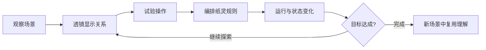

# 午夜学院 · 夜校协议：合并设计草案

本文件负责统一两份构思，描述游戏体验、候选规则、关卡方向、首版边界和可验证目标。续写时直接更新对应章节，注明重要取舍；修改经过写入 `../log.md`。

状态：2026-10-12 的前期合并草案，保留为历史参考。当前统一推荐方案见 [FINAL_GAME_PLAN.md](FINAL_GAME_PLAN.md)。本文中的候选机制不覆盖最终推荐方案，当前没有游戏实现。

## 0. 当前设计顺序

用户进一步提出先设计机制，再根据机制组织关卡，并要求保持玩法原创。当前采用“基础规则 → 后果与边界推演 → 机制实验 → 关卡 → 叙事与表现”的顺序，知识对应关系在构思过程中持续核对。

详见 [机制探索记录](MECHANIC_EXPLORATION.md)。其中“持续跟随与一次快照”是一个候选，不是已经确认的主机制。下文三关、指令集和点灯案例均保留为初版方向与验证素材，后续应根据选定机制调整。

## 1. 一句话方案

玩家进入一所依靠知识法术运作的午夜学院，通过透镜观察隐藏的连接与状态，试验世界的响应，再给纸灵编排行为规则。纸灵改变建筑，建筑的变化影响纸灵下一步的判断，玩家通过调试逐渐掌握世界的规律。

暂定游戏名：《夜校协议》。选题方向：The Midnight Academy。

## 2. 两份构思分别保留什么

### 来源 A：纸灵编程解谜

来源：[分析 AI 马拉松选题与分工](https://chatgpt.com/s/cx_6acbe964f75c8191b537ef11a7fbed48)。最后的方案提供以下基础：

- 纸灵自动执行玩家编写的条件与行动规则。
- 规则从上到下检查，每步执行第一条匹配规则。
- 行动引起装置状态变化，下一步依据新状态判断。
- 提供运行、暂停、单步和可理解的执行反馈。
- 用少量关卡控制首版规模。

### 来源 B：知识语法与世界互动

来源：用户提供的 `/Users/liyouran/Downloads/The_Midnight_Academy_Design_Notes.md`。保留以下设计原则：

- Lens 显示隐藏的属性、结构和关系。
- Operator 对世界施加明确、有限的操作。
- Relation 连接不同对象的输入和输出。
- 理解规则成为进度的一部分，同一能力可跨场景复用。
- 组合结果来自统一规则，接纳不同的有效解法。
- 保留世界内直接试验与可解释反馈，控制系统复杂度。

原笔记中的 70/20/10 比例、概率和频率示例、温度控制原型、技能列表及实体结构均保持为候选内容，不直接采用为首版规格。

## 3. 合并后的交互：观察、实验、自动化

两份构思分别强调编程编辑和世界直接操作。合并建议是让它们共用一套世界状态与操作规则，形成连续的体验。

1. **观察**：玩家先看到不工作的纸灵、断开的桥或没有响应的装置。
2. **透镜**：场景内显示可走路径、信号来源、端口连接及当前状态。
3. **试验**：玩家对允许交互的对象进行有限操作，验证自己的猜想。
4. **编排**：把理解到的操作条件写成纸灵的行为规则。
5. **运行**：纸灵自动行动，建筑即时表现状态变化。
6. **调试**：暂停或单步，检查哪条规则触发、改变了什么、为什么无法继续。
7. **迁移**：在新布局中使用同样的知识，找到另一种解决方案。



纸灵承担自动执行与可视化调试的角色。世界直接交互承担提出假设、布置环境和验证操作的角色。两者共同支持知识进入玩法。

## 4. 一个有限的世界模型

首版建议选用一个微缩图书馆庭院。场景由纸灵、地面节点、灯台、桥梁、出口和少量可配置端口组成。

先使用确定性的离散规则。固定斜视角负责建筑表现，底层逻辑负责可通行关系；画面中的视觉接触与实际道路连接必须能够区分。

### 4.1 Lens：连接透镜

一套透镜提供两类观察层：

- **路径层**：地面与平台形成节点，可走连接形成边；桥梁变化时相应的边改变。可以高亮纸灵当前可到达的区域。
- **信号层**：显示灯台等装置的状态输出、桥梁的控制输入，以及连接方向。

点击对象可查看相关状态。透镜提供证据与结构，不直接标出唯一答案。

### 4.2 Operator：有限操作

候选基础操作包括：

| 操作 | 作用 | 首版限制建议 |
| --- | --- | --- |
| 前进 | 沿朝向移动一个可通行连接 | 需要真实可走的边 |
| 左转 / 右转 | 改变纸灵朝向 | 与移动分开执行 |
| 开启当前装置 | 改变纸灵所在节点的可操作装置状态 | 条件与目标都应有效 |
| 布置对象 | 改变指定部件所在的合法槽位 | 仅在布置阶段，槽位数量有限 |
| 连接端口 | 建立允许的状态输出与控制输入关系 | 需要兼容端口，首版限制连接规模 |

这些是候选操作，不是已经实现的指令集。基础移动和开关动作属于操作语法；知识性来自玩家对条件、结构和因果的运用。

### 4.3 Relation：状态连接

首版建议使用简单的布尔信号：灯台状态通过连线控制桥梁，桥梁状态再影响路径图。

关系持久保存在场景中；规则执行时读写对象状态。每一步不重复创建连线，也不为每一对模块另外编写配方。

最初可限制每个控制输入只有一个有效来源，并拒绝不受支持的信号环路。多输入逻辑门、反馈回路、连续数值和时间延迟均属于后续扩展。

灯控制桥是状态联动；它本身不构成恒温器一类的负反馈。涉及反馈的扩展必须明确定义测量值、控制输出和环境响应。

## 5. 规则语法与执行顺序

首版编辑器建议用少量图形化规则卡片：

```text
WHEN [当前条件]
DO   [行动]
TO   [有效目标，可按行动隐含]
```

示例：

```text
1. 脚下有未开启的灯台 → 开启当前灯台
2. 前方道路可通行     → 前进
```

每一步的逻辑顺序建议固定为：

1. 检查是否已满足关卡目标；若满足，停止运行并显示结果。
2. 取得当前世界状态，从第一条规则开始检查条件。
3. 找到第一条匹配规则，校验它的目标和行动是否有效。
4. 执行一个原子行动。
5. 更新装置状态、信号传递和道路连接。
6. 记录触发规则、状态变化与结果，检查完成条件。
7. 下一步从第一条规则重新判断。

这是按优先级反复判断的行为规则系统。它不使用指令指针依次执行整个列表，也不在同一步执行所有满足条件的规则。

重复扫描能体现持续执行与状态驱动；首版尚未定义 `for`、`repeat` 或递归语法，相关教学范围不能预先宣称已经实现。

### 来源 B 的 UNTIL 如何结合

首版把停止条件放在关卡目标与运行控制中，保留简单执行模型。后续引入持续操作时，再定义 `UNTIL`、持续时间和并发语义；不将其直接混入当前“一步一个行动”的规则卡片。

## 6. 手动试验与程序执行如何一致

为保留直接操作的发现感，同时让运行结果可以重复比较，建议采用以下阶段：

- **布置阶段**：允许修改指定槽位、端口连接与程序。保存本次布置作为运行起点。
- **试验阶段**：可以手动尝试合法操作，并观察同一规则系统的响应。退出试验时恢复布置起点。
- **正式运行**：由纸灵程序改变任务状态；玩家可以观察、开启透镜、暂停与单步。
- **修改重试**：回到布置阶段，更改后重新建立运行起点。

手动试验与程序执行使用相同的 Operator 校验、状态更新和信号规则。自动化关卡的完成检查只在正式运行中进行，避免试验状态替代程序任务。

玩家可编辑的参数与不可编辑的初始任务状态应在界面中清楚区分。阶段名称、保存方式和具体编辑限制仍待原型试用。

## 7. 一段核心体验的逻辑推演

示例布局：`入口 S → 灯台 L → 平台 P → 桥端 G → 出口 E`。其中 `P → G` 的连接由灯台状态控制，初始关闭。纸灵始终面向这段直线路径。

使用上一节两条示例规则：

| 步骤 | 当前状态 | 触发操作 | 可见结果 |
| --- | --- | --- | --- |
| 1 | 位于 S，灯未亮 | 前进 | 走到 L |
| 2 | 位于 L，灯未亮 | 开启灯台 | 灯亮，桥接通 |
| 3 | 位于 L，灯已亮 | 前进 | 走到 P |
| 4 | 位于 P，桥已接通 | 前进 | 走到 G |
| 5 | 位于 G，前方可走 | 前进 | 抵达 E，完成 |

如果把“前方可走 → 前进”放到第一条，纸灵会经过 L 而不点灯，随后停在 P。此时反馈需要同时显示：道路断开、灯仍未亮，以及经过 L 时触发了哪条规则。

该表是设计层面的逻辑推演，不代表实际游戏已经完成通关测试。

## 8. 三个短关卡的候选安排

以下是此前合并构思形成的关卡草案。目前不先锁定关卡；应在核心机制探索通过后，按玩家需要发现的现象重排或替换它们。

### 第一关：没有亮起的灯

使用上面的直线路径，让玩家观察失败、调整规则优先级、成功开启桥梁。

知识重点：条件判断、第一匹配优先级和状态变化。入口提示只引导运行与观察，不要求先阅读理论。

### 第二关：看得见的断路

加入连接透镜和有限的端口布置。玩家需要查明灯台与桥梁的控制关系，试验一次连接，再让纸灵自动完成任务。

知识重点：图的连通性、方向关系与“状态来源改变目标状态”。具体槽位和合法连接仍需通过关卡草图验证。

### 第三关：会变化的庭院

同一出口提供两条候选路线，各有自己的装置依赖。允许玩家在有限布置中选择连接与路线，再编排适应这套布置的行为。

知识重点：状态变化导致路径变化、相同语法跨布局复用、通过结果验证方案。

目标是至少验证两种有意义的完整解法，例如选择不同路线或使用不同装置连接。简单增加无用规则不作为多解性的主要证据。目前关卡布局与多解性尚未验证。

## 9. 支持多解与知识驱动进度

关卡根据结果判断完成，例如纸灵到达出口、必要装置满足目标状态。除明确的任务限制外，不检查是否使用了指定卡片顺序或某一套参考程序。

统一操作校验可以让合法的非预期解法通过。已有知识能够在后续布局中复用；规则能力可以预先存在，展示和引导按关卡逐步展开。

知识名称与解释可以在玩家观察到结果后出现。例如先经历“灯亮之后道路连接变化”，再用简短说明介绍状态依赖和图结构。

这些原则不要求无限自由。首版只有有限对象、有限条件和兼容端口，从而维持可预测与可解释的系统。

## 10. 调试与失败反馈

运行时需要能够看见：

- 纸灵的位置、朝向和与当前判断有关的状态。
- 当前匹配的规则，以及它为什么成立。
- 执行的行动、目标和产生的状态差异。
- 变化后更新的装置连接与可走道路。

候选失败处理：

| 情况 | 建议反馈 |
| --- | --- |
| 无规则匹配 | 暂停，显示相关条件的当前值 |
| 行动或目标无效 | 暂停并解释原因，保持世界状态不变 |
| 确定性的完整状态重复 | 提示可能陷入循环，允许检查执行记录 |
| 超过运行步数预算 | 提示预算耗尽；不把这个结果直接当作死循环证明 |
| 布置产生断路或非法连接 | 在布置阶段标明问题，允许撤销或重置 |

循环检测需要包含所有会影响下一步行为的状态，并先检查目标。具体运行预算和检测方式待实现验证。

动画只表现已经由规则确定的行动，不能让画面与逻辑状态出现难以解释的分歧。

## 11. 视觉与交互方向

视觉借鉴《纪念碑谷》提出的简洁、梦幻建筑方向；角色、空间、机关、名称和素材采用原创设计。游戏采用固定斜视角、微缩浮空庭院、折纸造物和发光书页等候选元素。

场景承担主要视觉面积；编辑器和运行信息围绕场景组织。连接透镜叠加在原场景中，规则可以绑定或高亮对应对象。避免用独立答题页面承载知识。

正常观察时保持界面简洁，调试时按需要显露状态与因果。文本只承担任务目标、操作、反馈及必要的知识解释。

路径、机关状态和规则触发应有文字、形状或动画等冗余线索。颜色与声音不能作为唯一信息渠道。交互不应依赖连续精细拖动；运行、单步和对象选择需能使用清楚的按钮或点击操作。

以上为视觉与交互方向，尚未选定具体素材、色板、字体和引擎。

## 12. 建议首版与后续方向

### 原型建议

- 一个纸灵。
- 一个图书馆庭院场景的三个短关卡或布局变体。
- 一套连接透镜，观察路径与信号。
- 少量可编辑条件、行动与目标。
- 有限的场景布置和共用规则的手动试验。
- 运行、暂停、单步、重试和清楚的执行记录。
- 基于目标状态的成功判定。

体验目标可设为五到八分钟。前一份讨论中的两天目标用于控制范围；具体成本需要先验证一关完整体验再估计。

最先进行小范围机制推演与实验，检查同一套规则是否能产生不同的推理现象。之后再选择一关做完整体验，并逐步加入连接编辑与多解验证，避免同时制作所有界面与系统。

### 之后可考虑

- 更复杂的条件组合、循环模块和多纸灵协作。
- 数值型变量、阈值与持续控制。
- 温度测量、执行器和简化环境模型形成的负反馈实验。
- 频率与共振，前提是明确物理近似和可观察的响应。
- 概率型路径，前提是明确失败、重试和不确定性的规则。

这些候选机制通过独立的小型实验验证后，再评估是否进入主游戏。当前不把多个学科仿真一起纳入首版。

## 13. 原型验证目标

以下是后续需要验证的目标，不是已经通过的检查：

1. 玩家能通过观察与单步说明纸灵为什么跳过灯台。
2. 同一个操作在手动试验和程序执行中得到一致的状态变化。
3. 透镜显示的路径、信号与实际运行状态一致。
4. 每次重试能从明确的布置起点重复得到结果。
5. 无规则匹配、非法目标、运行超限和不可达状态都有可恢复的反馈。
6. 第三关至少有两种有意义且完整的合法解法，并且不会被参考答案检查拒绝。
7. 换一个布局后，同一套语法仍然适用。
8. 初次体验者能完成基本操作，提示有帮助且不会直接代替推理。

## 14. 参赛表达与范围取舍

扣题依据应来自实际交互：条件与优先级决定纸灵行为，图与状态依赖决定世界响应，调试使玩家发现规律。展示材料需要说明知识、游戏规则和原创设定各自承担什么作用。

现场演示建议展示一次可理解的失败、一次单步定位和一次修改后的成功，再展示另一种有效布置。上述演示需要原型实证支撑。

相近作品可从《异常》的编程行为和《纪念碑谷》的视觉表达入手整理。第二份笔记提到的其他参考作品保留为设计启发；正式提交时再核验具体对应点，选择最相近的一到两个进行比较，不宣称未经调研的首创性。

## 15. 仍待确定

- 具有足够探索深度的主机制，以及它对应的真实知识与抽象边界。
- 平台、引擎和最终发布形式。
- 合法槽位、端口类型、条件列表与指令数量。
- 三关实际布局、参考解法与替代解法。
- 手动试验的具体交互和重置边界。
- 纸灵移动与桥梁变化的动画时序。
- 最终名称、叙事、美术与音效。
- 实际团队分工、开发排期和主办方提交格式。

用户已要求把两份构思结合；本文完成的是合并设计，具体机制仍以之后的讨论和原型证据继续收敛。
