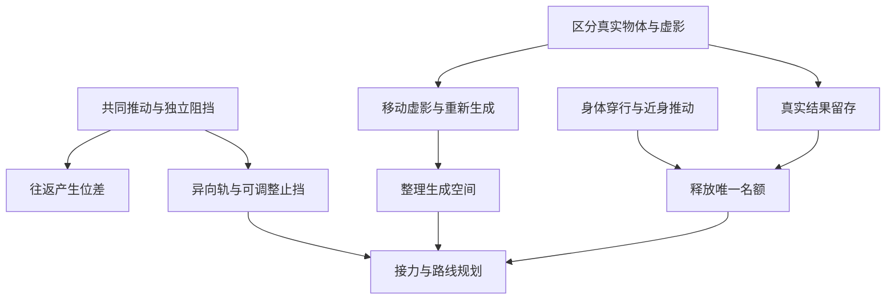

# 夜白映射：机制研究与关卡设计分析

日期：2026-10-14　｜　状态：机制研究稿，供新一轮关卡设计筛选

本文负责从团队 PRD 推导可发现的机制后果、提出物件候选，并给出最小谜题实验。本文中的推导和候选为本轮 AI 辅助分析，尚未经过团队采纳、完整关卡求解或新玩家试玩。它不替代 PRD，也不把候选写成已实现功能。续写时补充反例、实验结果和淘汰理由；正式采用的规则再进入当前方案，已完成的实现进入对应版本记录。

## 1. 研究结论

**下一套关卡最值得围绕三个问题展开：同一个输入怎样产生不同结果；哪些结果可以留下；下一次映射应该从哪里开始。**

映射系统已经有三个相互作用的核心：

1. **环境可以改变共同输入的结果。** 墙、轨道和其他实体既限制行动，也能帮助玩家制造、保存和清除两端的位置差。
2. **真实物体与虚影具有不同的存在方式。** 真实物体留下已经改变的位置；旧虚影被删除，新虚影依据真实源的当前位置重新生成。这提供了运输、重定位、临时阻挡等不同用途。
3. **唯一名额限制持续联系的数量。** 玩家可以先把进展保存在真实箱子、已到达的区域和已清空的空间中，再把名额交给另一件东西。

当前最优先研究的物件是：**可移动的无对应物箱子、可调整的止挡，以及可由不同实体接替占据的宽踏板。** 前两项能深入现有映射规则；宽踏板需要补充明确的接触定义。遮光片、异形框架和移动桥适合后续扩展。

建议先制作小型机制试验房，再决定正式关数。一个房间只有一项明确发现，也可以比同时出现许多装置更有推理价值。

## 2. 依据、版本与研究边界

### 2.1 以哪份规则为准

| 依据 | 本文用途 |
| --- | --- |
| [《夜白映射 PRD》v1.0](../夜白映射_PRD.md)，2026-10-13 | 核心依据，重点为 C01—C12、F01—F13，以及第 06—08 节 |
| [PRD 归档副本](sources/native_v1.2/夜白映射_PRD.md) | 与根目录版本逐字节一致；原文保持不变 |
| [单世界交互修订](UI_INTERACTION_AMENDMENT.md) | 保留单世界显示、Space 点按观察、身体与观察分离；不恢复 PRD 的 Tab 和双视图建议 |
| [当前逻辑门课程](LOGIC_GATES_CURRICULUM.md) | 识别现有演示与新研究的区别，不把五个逻辑门名称预设成新版五关结构 |
| [网页规则引擎](../web/engine.js)、[逻辑与光路](../web/science.js) | 仅用于判断当前实现覆盖到哪里；实现中的裁剪不作为 PRD 的规则上限 |

PRD SHA-256：`954301c43117595598d8e345a671244324892a42a421d5b6674d5389df69eff9`。

研究开始时仓库为 `codex/final-presentation` 的 `0b18699`，游戏源码基线为 `e253999`。本轮在独立研究分支整理文档，不修改游戏、部署文件或原始设计稿。

### 2.2 四种结论的身份

- **既定规则**：PRD 明确规定的行为，标注条款。
- **规则推导**：在写明的前提下，由既定规则得到的后果。
- **新增候选**：需要添加物件性质或补充规则；不能伪装成 PRD 已经规定。
- **待定语义**：PRD 没有充分定义，暂时不能用来承担谜底。

下文的房间均为机制实验草图，不是可直接交给程序照图实现的最终关卡。除附录的小型状态模型外，未做完整地图枚举；所有趣味、理解难度和教学效果仍待试玩。

## 3. 机制的准确模型

### 3.1 需要始终成立的契约

| 契约 | 依据 | 对关卡设计的含义 |
| --- | --- | --- |
| 两世界共享基础地形与坐标，建筑可以不同 | C01，第 04 节 | 沟壑必须两边都有；桥、墙和门可以制造不同的可达路线 |
| 对应物按身份预设配对，位置变化不改配 | C03、F02、F04 | 距离最近的箱子不会自动成为对应物 |
| 两端接收同方向的主动推动，各自判断阻挡 | C06、C07、F11、F12 | 可以一边动、一边停；受阻端仍能作为输入入口 |
| 只传播玩家主动水平推动 | 第 02 节、F13 | 重力、碰撞冲量和机关输出不会自动传到另一世界 |
| 真实物体解除后保留位置，重新绑定保留位差 | F08、F09 | 解除联系可以释放名额，已经完成的真实摆放仍然有效 |
| 无对应物才生成虚影；新虚影从源的当前位置、朝向生成 | F03、F09 | 移动虚影的旧位置可被舍弃，源的位置决定下一次生成位置 |
| 同时只有一组；预览不替换，合法确认才原子替换 | C11、F05—F07 | 玩家有安全的思考阶段，不能利用“两组短暂共存” |
| 生成要检查实体穿插，并排除将删除的旧虚影 | F06 | 清空目标空间、调整源位置都可能成为必要工作 |
| 远程无距离和视线限制；未映射真实物体可近身推动 | C10，第 02 节、T02 | 把对象放远或藏在墙后不能阻止遥控；身体接近可以节约名额 |
| 机关只接收本世界输入；接触持续有效，无默认锁存 | 第 04、06 节 | 箱子留下才能持续开门，不能把曾经踩过当作永久开门 |
| 观察不移动身体；传送门只移动身体并保留映射 | C08、C09，第 07 节 | 观察解决信息问题，走路和穿门解决可达问题 |
| 虚影可支撑、阻挡和接触机关；不能再作为生成源 | F03、F04、F10 | 同一实体可以有正面和负面作用，但不产生递归复制 |

### 3.2 一个足够简洁的数学描述

在单位格、无半格移动的分析模型中，一次方向输入为向量 `d`：

```text
夜端：pN' = pN + mN · d
白端：pW' = pW + mW · d
位置差：Δ = pW − pN
更新后：Δ' = Δ + (mW − mN) · d
```

`mN`、`mW` 分别为 0 或 1，表示对应世界是否允许这一步。实际连续运动如果被截停在半步，应使用各端真实位移；这套格子公式只用于研究机制。

- 两边都能动：共同移动，位置差保持。
- 只有一边能动：位置差改变。
- 两边都被挡：物体状态不变，不储存额外推力。

因此，玩家可以把障碍理解为**修改位置差的工具**。但位置差不是全部状态：同样差一格，贴着右墙与处在轨道中央，下一次向右的结果可能不同。谜题必须同时考虑绝对位置、局部障碍和身体位置。

### 3.3 真实配对与虚影配对的根本差异

| 动作 | 两件真实物体 | 真实源与虚影 |
| --- | --- | --- |
| 激活 | 连接当前两件物体，不移动它们 | 在源当前对应坐标生成虚影，须合法 |
| 推动 | 分别受阻，允许错位 | 同样分别受阻，允许错位 |
| 解除 | 两端位置都留下 | 源留下，虚影及其接触消失 |
| 重新激活 | 继续原身份与原位差 | 创建新虚影，不记忆旧虚影的位置 |

**解除后，真实配对留下两端的位置；虚影配对只留下源的位置。** 这是值得让玩家亲手比较的发现，不能只通过颜色介绍两种物体。

## 4. 现有规则能够产生什么

### D01：墙可以帮助我操作另一端

**推导依据：F11、F12。**

一端已经撞墙，输入仍会到达另一端。玩家可以把停止的一端当作稳定的参照，让另一端单独继续。

关卡价值来自目标要求两个不同位置。若两端目标总在同坐标，玩家很难理解为什么要允许错位。第一次呈现应让墙边的箱子仍有推动反馈，同时报告远端移动，避免被误认为操作失灵。

### D02：向右再向左，仍会留下位置差

**推导依据：共同输入与独立阻挡。**

夜轨范围 `[0,2]`，白轨范围 `[0,4]`，从 `(夜2，白2)` 开始：

| 操作 | 夜位置 | 白位置 | 发生的事 |
| --- | --- | --- | --- |
| 初始 | 2 | 2 | 两端对齐 |
| 右 | 2 | 3 | 夜端被挡，白端继续 |
| 左 | 1 | 2 | 两端各退一格 |

白箱回到出发位置，夜箱却向左移动了一格。整段输入的方向相抵，两个物体的结果不相抵。换成“左、右”，终态又会不同。

**玩家可以先把局面暂时变差，再借回程得到需要的局面。** 这比单纯增加轨道长度更能产生新的推理。反向推动也因此与撤销不同：撤销恢复整个过去状态，反向输入仍受当前障碍约束。

### D03：同一组可以像两根独立的调节杆

**推导依据：本地轨道限制方向。**

夜箱只能沿横轨移动，白箱只能沿竖轨移动。右输入只影响夜箱，下输入只影响白箱。两件物体仍在同一映射组，规则没有改变。

这提供了“相同控制经过不同环境后被分开”的简单实验。两端都摆成横轨，只能产生一个方向上的位差；换成异向轨或有转角的通道，位置安排会出现新的维度。

注意：纯横轨加纯竖轨往往太容易，适合建立猜想。后续要让某一段轨道重新允许两端同向移动，使玩家不能永远逐端独立调节。

### D04：把两端推到边界，可以重新建立已知状态

**推导依据：固定且可达的止挡。**

如果沿某个方向最终都能到达固定端点，持续推动可把许多不同起点收敛到同一终态。例如两条左端都为 0 的轨道，足够多次左推后都是 `(0,0)`。

这是玩家主动校准的一种办法，适合与“制造位差”形成对照：同样是撞墙，有时写入差异，有时清除差异。两条轨道的端点坐标不同，收敛结果也会保留固定差值，不能一律称为“对齐”。

### D05：两端分别能到达，不代表一起能到达

**推导依据：共同输入约束；附录 A 有有限枚举。**

在夜 `[0,2]`、白 `[0,4]` 的封闭横轨中，从 `(0,0)` 开始，只允许共同左右推动，可达的组合共有 9 个。夜箱单独可以到 2，白箱单独可以到 0，但组合 `(2,0)` 不可达。

这种问题可以引出“还缺少哪种调整方式”：更换止挡、在解除后近身推动一端，或寻找不同路线。前提是新方式已经可被理解，不能让玩家在实际无解的房间里盲试。

枚举结论仅适用于这组约束。加入近身推动、活动止挡或其他物件后，可达集合会改变。

### D06：已经完成的真实工作，可以释放名额

**推导依据：F08、F09 与持续接触。**

真实箱子留在踏板上，开门的原因是它仍在接触踏板。此时联系可以解除，名额可以交给桥。

真正值得设计的是选择**在哪里停止操作、留下什么状态**。如果每关都只是把唯一箱子推到唯一踏板，再选唯一桥，这项规则很快就只剩固定流程。

可增加同一箱子的两个可用停放位置：一个暂时打开身体路线，另一个为最终行动留下空间。玩家需要调整同一件东西的职责，而不是多做一次完全相同的开门操作。

### D07：虚影能通过“重新生成”抵达其移动路线之外

**推导依据：F03、F08、F09；这是 PRD 已有后果。**

两世界都有完整地面，夜侧没有墙，白侧 `x=4` 有不可绕过的墙。夜侧有一件无对应物的可移动箱，初始在 2；映射后白侧虚影也在 2。

| 操作 | 夜侧真实源 | 白侧虚影 |
| --- | --- | --- |
| 激活 | 2 | 2 |
| 右 | 3 | 3 |
| 右 | 4 | 3，被墙挡住 |
| 右 | 5 | 3 |
| 解除 | 5 | 不存在 |
| 重新映射 | 5 | 在 5 新生成 |

白侧新虚影出现在墙另一边。没有物体穿过墙：旧实例删除，新实例在合法位置生成。身体不会因此穿墙，真实对应物也不能这样重置。

这可以成为新版最鲜明的发现之一。其约束仍然很强：源必须真的到达相应位置；目标空间必须空闲；虚影始终占用唯一名额；源所在世界和影子所在世界各自有障碍。

设计时应主动接受这个解法，并重新检查所有“墙能永久困住虚影”的假设。若以后禁止这种重生成，等于修改 F09，不能靠单关特例悄悄封堵。

### D08：生成位置本身可以成为需要整理的资源

**推导依据：F06、F07。**

映射失败可能说明另一边的对应位置被实体占据。玩家有两条不同思路：搬走当地的占位物，或者移动真实源，换一个生成位置。

这会让“清出一块空地”与“把箱子搬到目标上”同样有价值。失败预览必须明确显示冲突的实体；不能用只存在于碰撞体的阻挡制造难度。

该现象还能区分两类映射：绑定已有真实物体不创建新实体，因此没有同一种生成占位检查。不要把绑定失败和生成失败混为一条模糊规则。

### D09：虚影既能帮助通行，也可能堵住通行

**推导依据：实体碰撞与解除删除。**

一件虚影可以压住踏板，也能堵住窄路。为了遥控真实源而生成的虚影，可能成为身体之后要清除的障碍。目标达成后，解除映射是正常的解题动作。

最简单的实验：真实源被远程推到本地踏板，源的围栏禁止近身操作；另一侧虚影此时挡住必要走廊。解除后真实源继续开本地门，虚影消失，身体经另一世界绕行。这里的“消失”有正面用途。

### D10：身体可以替映射承担一部分工作

**既定规则：未映射真实物体仍可近身推动；F12 规定主动组近推的传播。**

当桥占据名额时，玩家仍可走到另一件未映射真实箱旁边，亲手调整它。这给身体路线一个独立意义：到达物体附近，就可能把魔法留给更需要它的结构。

反过来，所有希望强制使用共同推动的校准实验，都必须检查身体是否能近推其中一端绕过难点。封闭可见轨道能合法限制身体接触；它仍然不能阻止远程映射。

这项能力在 PRD 中明确存在，当前网页未实现。新关卡不能因为 Demo 目前没有近推，就假定它永远不存在。

### D11：玩家所在的位置，也是一种会留下的结果

**推导依据：替换映射不会让身体回到起点。**

先借桥到岛上，再撤桥，并没有抹去已经完成的过桥。桥保存的是当前可走的路线；身体保存的是已经走到哪里。

因此，路线规划需要考察“从这个安全位置能切换到哪些结构”。两段路不必同时存在，只要玩家能够先后到达正确的落脚点。传送门进一步改变身体可用的本地路线，但不会搬动箱子。

基础教学可以使用线性安全岛。后续应加入回访或两条用途不同的路线，让玩家思考在哪个区域切换，而不是只在唯一岛上按一次映射。

### D12：一组映射可以同时产生多处接触

**推导依据：F03 复制碰撞形状、支撑和接触属性。**

一件足够长或具有孔洞的物体，可以同时接触两块踏板、保留中间通道，或者用一端承重、另一端阻挡。名额按物体组计数，并不按覆盖的格子数计数。

这让形状成为有价值的变量。首轮应固定朝向，只研究平移和空腔；不同时引入旋转、缩放和多箱连推。若物体把所有桥面和所有踏板一次包办，它又会消解唯一名额的意义，必须限制形状的用途。

### D13：合法替换可能把临时作用交给另一件物体

**条件推导：F05、F06；需要先构造可达的合法状态。**

如果旧虚影已移动到新源的对应坐标，新虚影可能在原位置接替其接触。检查新生成时，旧虚影应被排除；不要求两件影子短暂共存。

这里有两个重要边界：

1. 两件同世界固定源若本来就实体重叠，不能当作合法起点。可移动虚影形成错位后，才更容易出现“影子重叠、真实源不重叠”的候选状态。
2. 如果新源从开局就能直接生成在目标处，旧影子的准备过程没有必要。这只能算效果演示，尚未形成谜题。

支撑交接还需要新旧表面同高、身体只有合法接触而没有穿插、替换后重新判断支撑。移动平台的运动语义尚未确定，暂不把“站在空中换桥”作为首批关卡谜底。

## 5. 当前 Demo 还没有发挥出的空间

这里讨论的是研究覆盖面，不能据此认定已有课程没有教学价值。

| 当前网页情况 | 对新设计的影响 |
| --- | --- |
| 可动映射主要是 A 箱的一维轨道；虚影主要来自固定 B/C 桥 | 缺少“虚影自己移动、与源错位、删除后重定位”的整条发现链 |
| 两种侧向输入与固定轨道端点占主导 | 可以完成校准，但尚未研究异向轨道、活动止挡和形状约束 |
| 身体移动未提供 PRD 所述的未映射真实物体近推 | 尚未形成“走过去干活，以节约映射名额”的取舍 |
| OR 房间可只拨动 B 开关通关，已有相应规则路线记录 | 对 OR 的实验成立，但映射在这条解法中可以完全缺席 |
| XOR 按钮改变门，映射承担借桥 | 存在组合流程，但改变映射状态并不改变 XOR 两个输入的含义 |
| 光路由墙、门、固定镜面和感应器计算 | 可移动箱子或虚影挡光尚未实现，不能把遮光片方案标为现成功能 |

新一轮建议让映射操作直接改变学习对象：例如箱子的错位就是状态差，虚影的存续就是持续条件，实体占位就是局部约束。逻辑门可以继续作为本地装置使用；每个房间是否需要某种门，应由研究出的现象决定。

课堂标签、公式和完整线路答案可以放到主动札记中，先让玩家看到结果、提出预测。已解释过的知识仍可随时查阅，避免为了“发现感”隐藏基本操作。

## 6. 加入哪些物件最有价值

### 6.1 候选总表

“规则成本”指玩家要新学多少约定；“实现成本”根据当前网页的专用 A/B/C 模型作定性判断，没有工时估算。

| 物件 | 与映射发生的关系 | 规则身份 | 规则成本 / 当前实现成本 | 建议 |
| --- | --- | --- | --- | --- |
| 可移动的无对应物箱子 | 错位、重生成、临时挡路、局部接触 | PRD 已允许，网页待补 | 低 / 高 | 首先研究 |
| 横轨、竖轨、转角围栏 | 把共同方向输入分解成不同运动 | 已有局部约束的布局变化 | 低 / 中 | 首先研究 |
| 可移动止挡、放在箱轨上的门 | 玩家主动改写哪端会受阻 | 使用已有箱子、门和本地碰撞；动态细节需统一 | 低至中 / 中至高 | 首先研究 |
| 宽占位踏板 | 允许真实箱、虚影、玩家接替同一持续条件 | 新增：明确接受哪些实体与覆盖条件 | 低 / 中 | 第二批 |
| 固定朝向的凹形框架、长形箱 | 一个名额产生多个接触点和可穿过的空腔 | 现有实体规则的形状扩展 | 低至中 / 高 | 第二批 |
| 可移动遮光片 | 虚影出现、移动和消失改变本地光路 | 新增：实体对光的遮挡属性 | 中 / 中至高 | 第二批，优先于更多独立开关 |
| 固定朝向的可移动镜片 | 平移改变光束反射的位置，错位产生不同光路 | 新增可映射光学物件；不传播旋转 | 中 / 高 | 遮光片成立后研究 |
| 可平移桥面 | 桥的位置可被约束、错位与重生成 | 移动属性已有基础，支撑与承载需补全 | 中 / 高 | 延后，先只在空载时调整 |
| 单向止回闸 | 相同往返输入在一侧只能单向通过 | 新增方向性碰撞规则 | 中 / 中 | 备选，避免替代原有止挡技巧 |
| 重力落箱与承物托盘 | 一个世界的局部运动不传播到另一世界 | 重力独立已有依据，落物后果和承载未定义 | 高 / 高 | 暂存，不进入首批 |

### 6.2 可移动的无对应物箱子：优先级最高

它能一次打开四个研究方向，而且不需要添加新的映射按钮：

- 让源和影子被不同障碍阻挡，主动制造错位。
- 把源搬到某处，删除旧影子，在新位置生成。
- 利用影子临时压住机关或临时堵路，完成真实工作后撤去。
- 改变源的位置，解决另一世界生成空间被占用的问题。

必须清楚表现“有真实对应物”和“无对应物”，不能把两种箱子做成只能靠试错区分的同款外观。预览同时标出当前影子位置、将消失的位置和重新生成的位置；保持每次只显示一个世界，信息可以随观察切换呈现。

第一个实验只需一件源、一个建筑止挡和一个明确目标。不要一开始同时加入光束、多个门和形状拼接。

### 6.3 活动止挡：让玩家修改输入的结果

当前许多止挡由设计者固定摆好。若玩家能摆放一个普通真实箱作为止挡，或用本地踏板打开箱轨上的门，环境本身就成为可调整的工具。

完整的因果链可以是：

```text
摆放真实止挡 → 改变这一端的可动范围
→ 对映射组施加共同输入 → 写入新的位置差
→ 移开止挡 → 使用已经留下的位置差
```

不要让两箱发生连推。按 PRD，被别的箱子挡住就停止；调整止挡要由玩家绕到可推动的位置，或先映射另一真实物体组完成，随后解除并保留它。

**唯一名额在这里很有用：**玩家能先摆好真实止挡，再换组校准；如果止挡是虚影，换组后它会消失。相似布局因此可以产生“这次该选真物体还是临时影子”的比较。

轨道门只接本地踏板，不能用另一世界的按钮直接开它。首批布局还应保证开关门时轨道口没有被箱子或身体占住，避免把尚未确定的挤压行为变成谜底。

### 6.4 宽占位踏板：把持续条件交给别人

候选定义：踏板有可见的有效区域，任一兼容实体占据其中一个有效位置即为 1；多个实体同时在板上仍为 1；全部离开即为 0。它检测占位，不引入质量阈值或累加重量。

宽度必须足以让两个实体分别站立而不穿插。一个有价值的动作链是：

1. 虚影压住踏板，保持通道。
2. 玩家走上板的另一格，接过持续条件。
3. 切换映射去操纵真实箱，旧虚影消失，身体仍压板。
4. 真实箱进入空着的有效格。
5. 玩家离开，箱子继续压板，名额再次可释放。

这会自然产生接力与状态保存，而不需要定时器或隐藏锁存。必须明确教学“身体也能触发”，并确认箱子进入踏板的轨迹不会被玩家挡住。

这是新增物件语义。PRD 已有接触机关，但没有充分规定所有踏板是否都接受玩家，不能默认把所有现有踏板一起改成这个类型。

### 6.5 异形框架：把空的部分也当作功能

候选采用固定朝向、可平移的凹形或门框形物体。完整边框参与碰撞，中间孔洞保持可通行；虚影精确复制这套形状。

可能产生的发现：

- 为了生成框架，重要的是实体部分是否穿插，孔洞可以容纳合法的空隙或其他不相交物体。
- 两个端点可以分别接触两个本地踏板，中间仍允许身体通过。
- 一侧建筑挡住框架的一条边，另一侧继续移动，形状让共同推动出现新的截停位置。

首轮只选一种形状，固定方向，不加入旋转。必须按真实形状判断碰撞，不能用整块外接矩形把可见孔洞当成实心。不要制作覆盖全地图的巨大“一件物体”，使唯一名额形同虚设。

### 6.6 遮光片：让光路与映射直接发生关系

候选定义：遮光片是可移动实体，阻断其本世界内经过自身的光束；虚影复制遮光属性。光源与感应器固定，先不增加旋转。

它至少有三种用途：

- 共同推动让两边遮光片因止挡错位，一路亮、一路暗。
- 虚影生成就挡光，解除就恢复光路；真实源仍留在已经安排的位置。
- 为某个本地光门保持遮挡会占用名额，必须让真实物体接替，或先让身体通过再释放。

光门继续作为玩法。玩家研究的是实体位置与存在性如何改变光路，不必先背反射公式。已有光束渲染可提供反馈，但需要新增可移动物体遮光计算，不能只画一条视觉上穿过箱子的光线。

映射镜片适合更后面：先固定朝向研究平移，完整说明复制的是镜面的形状和方向；源世界的机关连线与输出不能随镜片一起跨世界接过去。

## 7. 可先搭建的八个最小实验

这些是用于发现谜题的种子。排列暂不等于最终游戏顺序。每个房间应先用少量几何体证明必要性，再加入学院表现。

### E01 · 回来的不是原点

- **研究 D02。** 一对真实箱、不同长度的封闭横轨，身体无法近推。
- **预期猜想：**往返输入会抵消。
- **关键实验：**从 `(2,2)` 做“右、左”，观察 `(1,2)`；再用这种往返结果满足两个错位目标。
- **应用变化：**移动止挡位置，要求玩家在操作前预测哪端会留下位移。
- **必要性检查：**如果两端实际位移被强制相同，这个目标应不可达。
- **淘汰信号：**玩家只靠逐格枚举碰巧完成，无法预测另一组往返输入。

### E02 · 借一堵墙

- **研究 D01、D06；采用活动真实止挡。** 一个用于校准的真实配对组，另一件可调整的真实止挡。
- **空间问题：**固定环境没有提供需要的截停位置，玩家要先把止挡摆好。
- **关键链条：**布置止挡 → 解除原组 → 映射待校准组 → 形成位差 → 使用结果。
- **必要性检查：**移除止挡对箱子的碰撞后，原校准策略应失效。
- **捷径检查：**两端目标是否从起点直接共同推动就能达到；身体是否能绕到箱子后面独立校准。若能，接受合法替代解或修改透明的几何约束。

### E03 · 影子换一个起点

- **研究 D07。** 使用第 4 节的 `2→5` 例子；白侧墙阻挡箱子移动，夜侧同坐标是完整地面。
- **目标：**让白侧虚影出现在墙另一边的槽中。
- **关键链条：**推源越过对应坐标 → 看见影子留在墙前 → 解除 → 重新映射。
- **必要性检查：**若重新映射仍恢复旧影子位置，这条解法应失效。
- **捷径检查：**白侧不能从墙边绕行；初始源的位置不能直接生成到目标；目标位置不能靠缺失碰撞接受重叠。
- **后续变化：**把目标生成位置先占住，让玩家在移动源与清空另一侧之间选择。

### E04 · 事情做完以后

- **研究 D06、D09。** 无对应物的真实源被围在夜侧轨道内；夜踏板开夜门；源调整完成时，其白侧虚影挡住必要的白走廊。
- **目标：**保留夜门开启，经白侧路线抵达夜侧终点。
- **关键链条：**遥控源到板 → 解除 → 真实源留住门，白侧障碍消失 → 身体穿行。
- **必要性检查：**若解除让源归位，门会关闭；若虚影不消失，路线继续受阻。
- **捷径检查：**禁止身体直接接触源的理由必须是可见围栏；白走廊不能有绕路；白侧不直接驱动夜门。

### E05 · 把魔法留给桥

- **研究 D10。** 一座虚影桥通向唯一登陆口，普通可推箱挡在登陆口，向前一格有空地；推开后玩家可以从登陆格转向出口。
- **预期猜想：**所有箱子都必须先映射才能动。
- **先做清楚的教学版本：**普通箱没有映射标记，不能远程选中，但可近身推。PRD 已区分可映射对象并允许真实物体近推；这里组合这两种属性，必须有可辨认的外观和选择反馈。
- **关键链条：**保留桥映射 → 身体走到最后一段虚影桥 → 把普通箱推入前方空格 → 身体进入永久登陆格，再转向出口。玩家不需要站在无支撑处切换魔法。
- **教学要求：**在安全平面先演示近推，不能直到谜底才暴露操作。
- **应用变体：**把普通箱换成可映射箱，研究何时近推能够节约名额，何时提前遥控更合适，允许玩家比较方法。
- **捷径检查：**可映射箱若能在过桥前远程摆好，再换桥通关，就不能声称该变体强制近推。原教学图还要检查登陆口侧面绕行、身体推箱所需空间和落脚判定；目前未完成精确地图求解。

### E06 · 接过这一端

- **研究宽踏板候选。** 先在安全区域完成“虚影 → 身体 → 真实箱”的持续占位接力。
- **玩家发现：**门是否开启只看谁仍在接触，映射名额可以在条件持续时换用途。
- **关键应用：**结束时由真实箱留住通道，使玩家和唯一名额都空出来。
- **必要性检查：**踏板缩为只容一件物体，或禁止身体触发后，接力策略应改变。
- **捷径检查：**真实箱能否从开局直接摆上板；玩家能否先过门再随便关门。缺少对接力的实际需求，就只保留为安全实验，不扩成正式难关。

### E07 · 让它在那里消失

- **研究遮光片候选。** 光片的实体位置阻挡本地光路，另一端在不同止挡下产生错位。
- **关键应用：**先利用遮挡安排身体路线，再撤去虚影让当地光路恢复；真实源的位置保留，影响其本世界的另一条光路。
- **必要性检查：**移除虚影的遮光性，或改成两端持续位置同步，关键路线应变化。
- **捷径检查：**是否只拨现有按钮就能得到同样输出；是否把两侧感应器直接接成未说明的跨世界门。
- **取舍：**首个房间只用一束光，先让“出现与消失”产生明确结果，再增加两端错位。

### E08 · 一件东西，两处作用

- **研究 D12。** 固定朝向的凹形框架，其两端可以压住两块本地踏板，中间留出身体通道。
- **预期猜想：**两个作用点需要两个映射名额。
- **关键应用：**选对位置，一件实体同时产生多处接触，空腔保留通路。
- **必要性检查：**改为实心同外形物体后，身体路径应受阻；改为短物体后，两块板不能同时接触。
- **捷径检查：**普通箱是否也能同时覆盖两板；门是否只要过一次就可不再维持；虚影生成是否与身体或其他实体穿插。
- **后续变化：**让同一形状在两个世界被不同位置的建筑截停，用几何复用 D02 的位差推理。

## 8. 让发现形成递进

### 8.1 以玩家修正的猜想组织章节

| 发现阶段 | 玩家可能持有的猜想 | 房间给出的可观察反例 | 学会后能主动做什么 |
| --- | --- | --- | --- |
| 共同输入 | 两端永远一起移动 | 一端碰墙，另一端继续 | 利用止挡调节相对位置 |
| 操作顺序 | 反方向能恢复刚才的操作 | 往返后只有一端回到原点 | 设计有净结果的往返序列 |
| 真实状态 | 解除会让全部结果消失 | 真实箱继续压板 | 完成一项工作后释放名额 |
| 虚影状态 | 重连会恢复旧影子 | 新影子从源的新位置出现 | 准备源的位置，选择生成位置 |
| 空间占用 | 映射只会增加帮助 | 虚影挡住路或光束 | 主动取消已经完成任务的映射 |
| 身体的作用 | 一切都依赖遥控 | 近推可在桥保持时工作 | 用身体路线节约名额 |
| 组合 | 许多条件必须同时保持映射 | 真物、身体和临时影子分别保留部分结果 | 自己安排工作次序与交接 |

每个发现宜采用三步：**先给安全的可重复现象，再给需要应用的目标，最后换一种布局检查迁移。** 不用长篇对话替代实验，也不把第一次出现的规则藏在关底。

### 8.2 依赖关系



不要求把每个节点做成独立一关。部分节点可以成为一个房间中的两次实验；重要的是后面的谜题真正需要之前获得的理解。

### 8.3 组合关应产生相互影响

优先考虑三类组合：

- **改变约束再校准：**先摆止挡，改变另一组共同输入的结果；获得的位差又决定能否释放名额。
- **真实准备与虚影重定位：**先移动源形成正确出生位置，再清空对应区域，最后决定何时生成。
- **持续条件的交接：**真物、虚影或身体先后维持同一条件，使另一个动作获得操作机会。

如果“做完逻辑门题”和“选择桥”之间可以互换顺序、彼此状态毫无影响，这更接近两个连续小任务。综合关应检查其中一步是否改变另一步的可行操作，或让玩家重新评估已学性质的用途。

### 8.4 Academy 的知识可以从这些发现中生长

| 玩家已经验证的现象 | 可以在事后解释的真实知识 | 适用边界 |
| --- | --- | --- |
| 两边同样移动时位置差不变 | 平移与相对位置的不变量 | 遇到不同阻挡，前提改变，位置差就可能变化 |
| 先右后左与先左后右得到不同结果 | 操作顺序、非可逆状态变化 | 指有边界约束的这组操作；撤销另有完整状态记录 |
| 每个箱子能分别到目标，组合却不可达 | 约束系统的可达状态 | 必须写清允许的操作；加入近推后结论可能改变 |
| 真实箱留住条件，名额转交给桥 | 持续状态与有限资源的安排 | 门仍依赖当前接触，没有暗中变成锁存机关 |
| 解除再生成后，影子出现在新位置 | 对象的存在周期、源位置与新实例 | 这是游戏系统的状态规则，不能解释为真实物体跨墙运动 |
| 真物、身体与虚影轮流压住同一板 | 持续条件与职责交接 | 宽踏板的接触规则需预先明确，不能自动套用到所有踏板 |

学派札记可在实验后用一两句话命名玩家已经做出的发现。保留本地逻辑门时，也应让真值来自可见物件的状态。这样知识解释有操作证据，学院身份也能与房间中的工作对应。

## 9. 有吸引力但需要克制的方向

| 方向 | 主要问题 | 处理建议 |
| --- | --- | --- |
| 再加几个独立按钮和不同逻辑门 | 容易让玩家研究按钮真值，映射只承担通路背景 | 优先把输入改为映射物体的实际位置、存在与接触 |
| 地图变大、物体更远 | 无限距离遥控会消解这类障碍，增加的主要是走路时间 | 用生成冲突、身体可达性或本地约束构成问题 |
| 要求记住切屏前的位置 | 容易增加记忆负担，不能证明理解了机制 | 提供一致坐标、身份符号、轨道刻度和简短双端反馈 |
| 为谜题临时禁止某个合法遥控方向 | 破坏相同规则下的预测 | 用可见几何和已教学的物体属性表达限制 |
| 计时门、消失倒计时 | 将资源规划转为反应速度，偏离当前 PRD | 首轮全部用持续状态和稳定落脚点 |
| 自由配对、多个名额、影子再生影子 | 改变 C03、C11、F04，重写核心问题空间 | 作为另一个玩法分支评估，不混入这套研究 |
| 相机旋转让推动方向翻转 | 会混淆固定世界坐标，需要新的方向变换规则 | 本轮不采用，保持方向含义稳定 |
| 源门开了，映射出的门也跟着开 | 可能偷偷复制机关输出，绕过世界独立性 | 带线路物体必须先定义本地连接；优先映射简单几何物体 |
| 把失败恢复当作搬运方法 | 检查点应恢复完整状态，不能只移动身体而保留新结果 | 排除不完整恢复形成的捷径 |

### 一个应当主动淘汰的“伪谜题”

假设设计者要求：先让 A 的虚影压在白侧 `x=3`，再把位于夜侧 `x=3` 的 B 映射过去，接替 A。

这条操作链可以发生，但若 B 从开局就能合法生成在白 3，玩家直接映射 B 即可。A 的存在没有形成必要的推理。

要把它发展成谜题，必须让 A 的作用先创造某个 B 尚不具备的条件，例如身体抵达 B 旁边后才能近推它离开生成冲突区。同时仍要检查：玩家能否在更早阶段直接遥控 B 完成同样工作。

**一条好看的示范解不能证明关卡成立。** 正式设计还需要找到最便宜的合法替代路线，并判断它保留了什么发现。

## 10. 需要先统一的语义

这些问题不阻止本轮研究，但相应行为不能未经说明就承担谜底。

| 未充分确定的行为 | 本文采用的保守边界 | 后续应怎样决定 |
| --- | --- | --- |
| 移动物体遇到玩家 | 不以玩家充当万能止挡或被推挤作为首批技巧 | 明确遥控推物是否停下、搬运或推开玩家；同类情况保持一致 |
| 玩家站在可移动桥上时桥移动 | 首批只研究空载平移 | 若支持承载，定义乘客跟随、撞顶、侧向受阻与撤销 |
| 物体或虚影在无支撑处生成、掉落 | 重生成实验全部放在稳定地面 | 定义立即结算顺序、物体掉落是否失败，以及源掉落后的联系 |
| 轨道限制属于物体还是世界 | 本文异向轨由各世界真实围栏形成 | 区分物体本身的可动属性与环境约束，避免影子携带不可见轨道 |
| 门正要关闭但门洞被占据 | 不设计靠挤门或卡住门的谜底 | 现有网页已有占用保护；若成为正式机制，需统一到物体和身体 |
| 同一次替换中的接触与机关更新 | 以合法提交后的完整状态判断持续接触 | 避免旧影子删除时的中间帧被当成一次隐藏断电或掉落 |
| 宽踏板接触者与覆盖阈值 | 只在新增宽踏板中明确接受身体、真箱和虚影 | 普通踏板保留原定义，外观与说明可区分 |
| 光学性质怎样复制 | 遮光片只复制其本地遮光属性 | 不复制跨世界线路，不把所有实体默认变成光学物件 |

优先做不依赖这些悬而未决行为的实验。若某个候选只有不断补例外才能成立，应降低它的优先级。

## 11. 下一轮研究方法与筛选标准

### 11.1 先探索状态，再安排出口

1. 选一至两条机制，例如“独立阻挡”和“重生成”。
2. 给少量物体与明显几何约束，记录它们产生的所有不同结果。
3. 寻找能修正玩家猜想的状态变化，例如源越过了坐标，影子却没有，随后能重新出现在另一侧。
4. 再选择一个必须理解该变化才能有效达到的目标。
5. 尝试更短的合法路线，特别是近身推动、远程提前准备、先穿门后改状态。
6. 去掉不影响推理的走路、重复操作和机关。
7. 给已学会规则的人换一张结构不同的图，观察能否自行迁移。

第一版分析模型可用有限网格。把玩家、所有真实物体、虚影位置、当前组与本地机关纳入完整状态；相机视角只在其改变可用输入时处理，不能把切屏误作物理推进。

### 11.2 每张草图都要回答

- 玩家原来会怎么想，哪一次反馈会让他修正猜想？
- 关键现象能否在安全空间重复？有没有把操作秘密藏在谜底？
- 若移除关键规则，目标、可达状态或解法结构发生什么变化？
- 是否存在只拨按钮、不映射的通关路线？若有，这关是否仍满足研究目的？
- 未映射物体近推、从远处提前遥控、解除再生成，会不会直接跳过关键过程？
- 有没有靠不同天然地形、未说明的跨世界线路或临时禁用操作维持难度？
- 玩家需要的是调整物体、改变存在状态、安排身体位置，还是仅仅多走一段路？
- 已到达的真实状态为什么会继续有效？画面能否显示原因？
- 撤销与完整检查点是否能恢复失败前的机会？
- 一个遵守规则的意外解，能否被保留为玩家的发现？

不以唯一解作为普遍目标。允许不同路线，只要它们仍通过规则取得结果；如果另一条路线完全略过了本关唯一想教的现象，就调整布局或重新定位这张图。

### 11.3 判断玩家是否真的理解

通关以后，把目标或止挡换个位置，先让玩家预测，再动手。观察他是否能解释：哪边会受阻、什么会留下、新影子会在哪里出现、何时可以释放名额。

如果玩家成功一次却无法对相似情况作预测，记录为“完成操作”，不要直接记录为“理解机制”。如果玩家理解规则仍觉得无聊，减少重复搬运，并寻找需要重新组合规律的目标。

本轮没有测量通关率、体验时长或乐趣分数，也没有把纸面可达性当成玩家体验证据。

## 12. 推荐推进顺序

### 第一批：最大化利用 PRD 已有规则

优先研究 **E01 往返位差、E02 活动止挡、E03 虚影重新生成、E04 主动解除**。保留少量原型已有的桥与传送门，等到这些现象分别成立，再研究相互影响。

实现研究用灰盒之前，需要把当前网页的专用模型扩展为多物体模型：物体有身份、世界、可动性、真实对应物或空值，虚影保存自己的当前位置。近推与远程推激活组需共用输入语义。这个改造属于补齐 PRD，不能只给固定桥更换皮肤来替代。

### 第二批：增加有明确组合价值的物件

从**宽踏板、凹形框架、遮光片**中每次只选一个。它至少应产生两种用途，例如遮光片既能通过错位改变光路，也能通过删除虚影恢复光路。若只得到“碰到专用开关就开专用门”的单一用途，暂不扩大内容。

### 第三批：条件成熟后研究支撑与承载

移动桥、虚影接替支撑、独立重力等方向具有潜力，也最容易依赖尚未定义的物理细节。先完成语义与安全实验，再考虑作为综合谜题。

**下一套关卡的核心承诺可以是：玩家逐渐学会安排差异、留下结果，并决定哪些东西此刻需要存在。** 学院的课程名称和叙事随后围绕这些真实发生的发现组织；关卡不必预先被限定为五种逻辑门各一题。

## 附录 A：本轮有限状态推演

本轮执行了一个独立 Python 纸面模型，没有运行游戏自动测试或修改引擎。模型只包含一对单位格真实箱、两个封闭横轨、共同左右输入与独立边界截停；不含身体、近推、机关、虚影和其他物体。

条件：夜 `[0,2]`、白 `[0,4]`、初始 `(0,0)`。广度优先枚举得到 9 个可达状态：

```text
(0,0) (0,1) (0,2)
      (1,1) (1,2) (1,3)
            (2,2) (2,3) (2,4)
```

结果：

- `(2,0)` 不在可达集合中。可达状态均满足 `0 ≤ 白−夜 ≤ 2`，不是任意两端独立可达位置都能组合。
- 从可达状态 `(2,2)` 输入 `右、左`，依次得到 `(2,3)`、`(1,2)`。
- 从这 9 个状态中的任一个开始，连续 4 次左推均到达 `(0,0)`。
- 另按 D07 的条件执行了三次右推，轨迹为 `(2,2)→(3,3)→(4,3)→(5,3)`；合法重生成将其变为 `(5,5)`。该算例只核对位置规则，不证明完整房间和身体路线可解。

一维枚举的最小复现代码：

```python
from collections import deque

bounds = ((0, 2), (0, 4))
def step(state, direction):
    return tuple(max(lo, min(hi, x + direction))
                 for x, (lo, hi) in zip(state, bounds))

queue = deque([(0, 0)])
seen = {(0, 0)}
while queue:
    state = queue.popleft()
    for direction in (-1, 1):
        target = step(state, direction)
        if target not in seen:
            seen.add(target)
            queue.append(target)
print(len(seen), sorted(seen))
```

## 附录 B：本轮交付边界

- 已完成：PRD 原文与副本核对、规则归纳、当前实现差距阅读、有限状态算例、机制推导、物件候选和最小实验草图。
- 尚未完成：八张草图的精确双世界地图、完整求解与捷径检查、可移动虚影灰盒、新玩家发现过程与乐趣验证。
- 本轮不改游戏实现、不发布新关卡、不将研究稿视为团队已批准的新需求。
